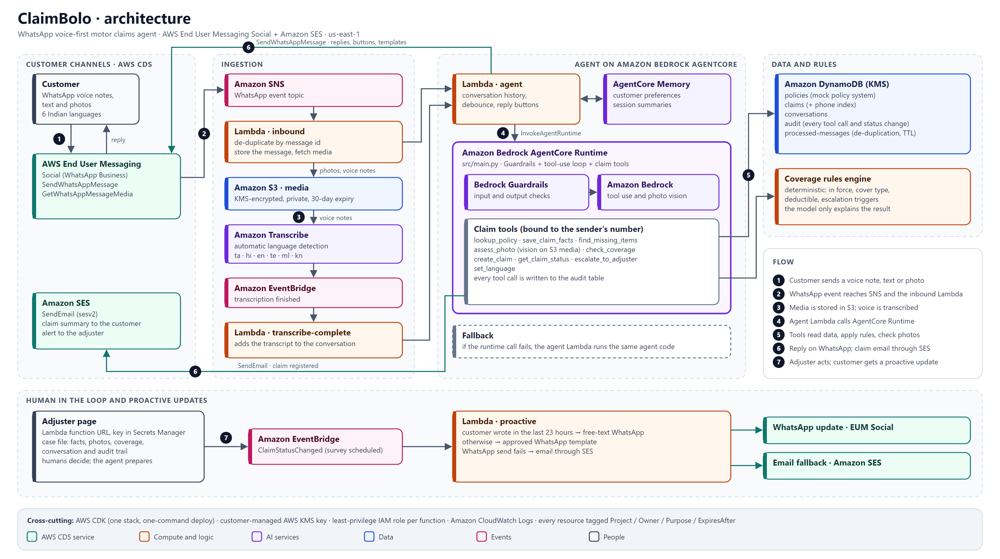

# Architecture

Source: [architecture.svg](architecture.svg), generated by [diagram/build_diagram.js](diagram/build_diagram.js). The Mermaid version below shows the same flows.

```mermaid
flowchart LR
  C([Customer on WhatsApp]) <--> EUM[AWS End User Messaging Social]
  EUM -->|inbound events| SNS[(SNS topic)]
  SNS --> IN[inbound Lambda<br/>de-dupe, store, media]
  IN -->|GetWhatsAppMessageMedia| S3[(S3 media, KMS)]
  S3 --> TR[Amazon Transcribe<br/>language detection]
  TR -->|EventBridge| TC[transcribe-complete Lambda]
  IN --> AG
  TC --> AG[agent Lambda<br/>channel I/O, memory]
  AG -->|InvokeAgentRuntime| RT[AgentCore Runtime<br/>Guardrails + Bedrock tool-use loop + tools]
  GR[Bedrock Guardrails] --- RT
  MEM[AgentCore Memory] --- AG
  RT --> TOOLS[Tools: policy, facts, missing items,<br/>photo check, coverage rules, claim, status, escalate]
  TOOLS --> DDB[(DynamoDB: policies, claims,<br/>conversations, audit)]
  AG -->|SendWhatsAppMessage| EUM
  AG -->|SendEmail| SES[Amazon SES]
  ADJ[Adjuster page<br/>Lambda URL] -->|status change| EB[EventBridge]
  EB --> PRO[proactive Lambda]
  PRO -->|inside 24h: text, outside: template| EUM
  PRO -->|fallback| SES
```

## Flows

**Inbound.** WhatsApp → EUM Social → SNS → `inbound` Lambda. The Lambda de-duplicates by WhatsApp message id (`processed-messages` table, released again if processing fails), stores the message, downloads media with `GetWhatsAppMessageMedia`, and for voice notes starts a Transcribe job with language detection. Text and photos go straight to the agent; voice notes go after the `transcribe-complete` Lambda receives the job-finished event.

**Agent.** The agent Lambda rebuilds the conversation from the log and calls **AgentCore Runtime** (`InvokeAgentRuntime`). The runtime (`src/main.py`) screens input and output with Bedrock Guardrails and runs the Bedrock tool-use loop. The Lambda then sends the reply and records the exchange to AgentCore Memory, which extracts customer preferences and session summaries in the background. If the runtime call fails, the Lambda runs the same agent code locally. Every tool is bound to the sender's phone number and writes an audit record.

**Coverage.** `src/rules/coverage.py` decides whether the policy covers the damage. The model only explains the result.

**Proactive.** The adjuster page changes a claim's status and emits an EventBridge event. The `proactive` Lambda sends free text if the customer wrote in the last 23 hours, otherwise an approved template, and falls back to SES email if WhatsApp fails.

## Infrastructure

AWS CDK (Python), `infrastructure/`. One stack creates the KMS key, media bucket, SNS topic, five DynamoDB tables, SES configuration set, Lambdas, EventBridge rules, Bedrock Guardrail, AgentCore Memory, and the adjuster secret. Every resource is tagged `Project`, `Owner`, `Purpose`, `ExpiresAfter`.
